# CompásZero 🎤📓

Cuaderno de rimas para Android: escribe frases sueltas, recibe sugerencias de rima, revisa ortografía, busca bases gratuitas y graba tus versos sobre el beat.

> **Compás** = la métrica del verso (y del beat). **Zero** = la hoja en blanco, el punto de partida.

## Funciones (MVP → futuro)

### 1. Cuaderno (núcleo)
- **Libretas** → **Canciones** → **Secciones** (intro, verso, coro, puente, outro).
- **Barras sueltas**: botón rápido "+ barra" para anotar una frase en 2 segundos (también desde widget o notificación).
- **Banco de ideas**: frases sin canción asignada; arrastrarlas luego a una canción.
- Etiquetas (temas, estados de ánimo), búsqueda y favoritos.
- Autoguardado, historial de versiones y modo sin conexión.

### 2. Asistente de rimas
- Rimas **consonantes** y **asonantes** en español (por la vocal tónica y lo que sigue).
- **Rimas multisilábicas** e internas, resaltadas con colores en el texto.
- **Contador de sílabas** por barra (para encajar en el compás).
- Sugerencias discretas: se activan al tocar la última palabra o en un panel lateral, nunca invasivas.
- Diccionario de sinónimos y jerga/slang.

### 3. Ortografía
- Revisión en español (diccionario Hunspell es_ES / es_419) con subrayado.
- Opción para **ignorar palabras de jerga** y diccionario personal (el rap rompe reglas a propósito).

### 4. Bases (beats)
- Catálogo de **beats gratuitos con licencia libre** (Free Music Archive, ccMixter, Jamendo, beats propios subidos por el usuario).
- Filtros por **BPM**, estilo (boom bap, trap, drill, lo-fi, jazz rap) y tono.
- Reproductor con loop, velocidad y **metrónomo**.
- Vincular una base a cada canción.
- ⚠️ Mostrar siempre licencia y autor; no usar YouTube "type beats" sin permiso.

### 5. Grabación
- Grabar tomas **sobre la base** (con auriculares) o a capela.
- Tomas asociadas a cada sección, con nombre y marcador de tiempo.
- **Modo teleprompter**: la letra se desplaza mientras grabas.
- Exportar/compartir audio (m4a) y letra (texto/PDF).

### 6. Extras con sentido
- **Modo freestyle**: palabra aleatoria cada X compases sobre la base.
- Reto diario (una palabra/tema al día) y racha de escritura.
- Modo oscuro por defecto, tipografía grande y legible.
- Copia de seguridad en Google Drive.

## Stack propuesto
| Capa | Tecnología |
|---|---|
| Lenguaje / UI | Kotlin + Jetpack Compose (Material 3) |
| Datos locales | Room (SQLite) |
| Audio | Media3 ExoPlayer (bases) + MediaRecorder/AudioRecord (voz) |
| Rimas | Motor propio de silabeo/fonética en español + diccionario offline |
| Ortografía | Hunspell (es) |
| Bases | API de Jamendo / FMA + subida local |
| Arquitectura | MVVM + Hilt, modular (`:notebook`, `:rhymes`, `:beats`, `:recorder`) |

## Identidad visual

**Lema:** *Antes del beat, nace la idea.*

El símbolo es un **0** atravesado por una línea vertical (barra de compás / cursor / micrófono) con un **punto rojo** (REC). Resume la app: hoja en blanco + ritmo + grabar.

| Token | Color | Uso |
|---|---|---|
| Negro tinta | `#0E0E0E` | Fondo principal (modo oscuro por defecto) |
| Blanco tiza | `#F5F5F5` | Texto, trazos, iconos |
| Rojo REC | `#E5194B` | Grabar, acentos, rima activa (usar poco) |
| Gris grafito | `#2A2A2A` / `#8A8A8A` | Tarjetas, texto secundario |

- **Tipografías:** grafiti solo para el logo y títulos grandes; *Inter/Roboto* en la UI; mono (*JetBrains Mono*) para las letras, para alinear sílabas.
- **El punto rojo es el botón de grabar** en toda la app; parpadea mientras graba.
- Archivos: `docs/brand/logo.svg` (logo completo) y `docs/brand/icon.svg` (símbolo), vectoriales; el punto rojo late (100% → 40%) con halo.
- **La línea vertical** marca el pulso: en el editor puede moverse al tempo de la base como metrónomo visual.
- Rimas resaltadas con subrayados tipo spray (blanco, rojo y variaciones de gris/rosa).
- Salpicaduras de spray en estados vacíos ("Tu primera barra empieza aquí").
- **Icono Android:** solo el 0 con punto rojo sobre negro; versión monocroma para Android 13+. El texto grafiti no se lee en tamaño icono.
- **Splash:** el 0 aparece, la línea cae como un beat y el punto rojo se enciende.

## Hoja de ruta
1. **v0.1** – Cuaderno + barras sueltas + contador de sílabas.
2. **v0.2** – Motor de rimas + ortografía.
3. **v0.3** – Reproductor de bases + catálogo libre.
4. **v0.4** – Grabación sobre base + teleprompter.
5. **v1.0** – Backup, freestyle, pulido visual y Play Store.
